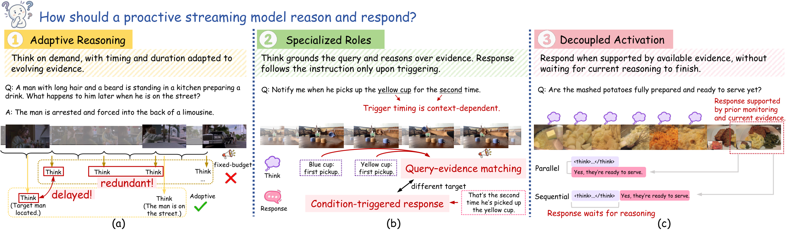
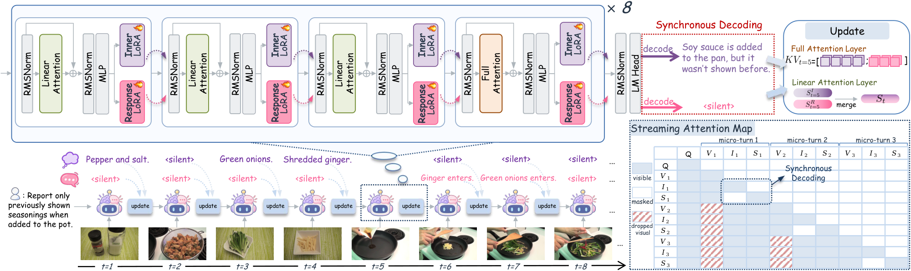
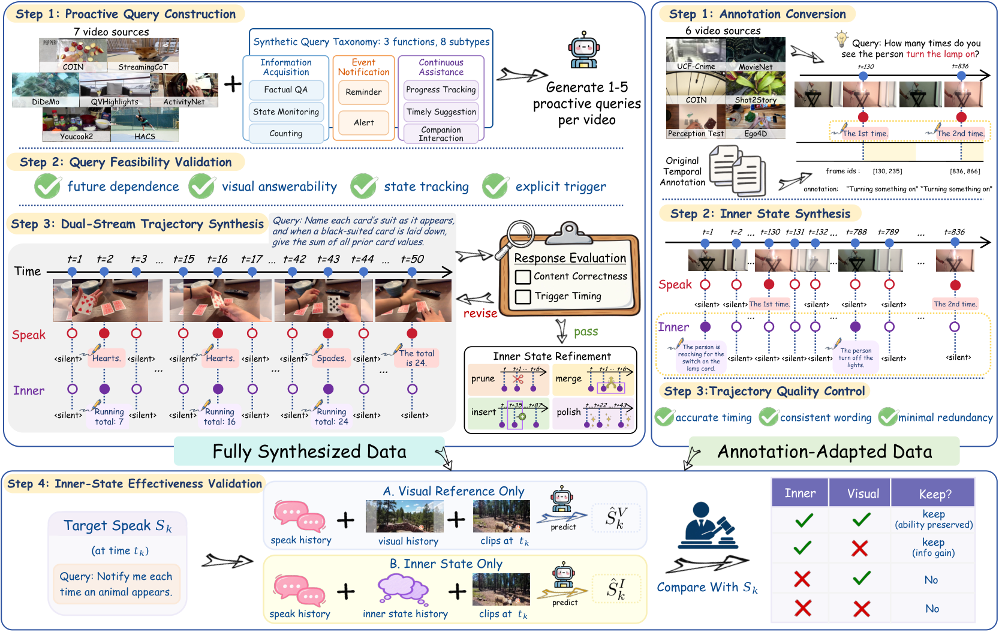
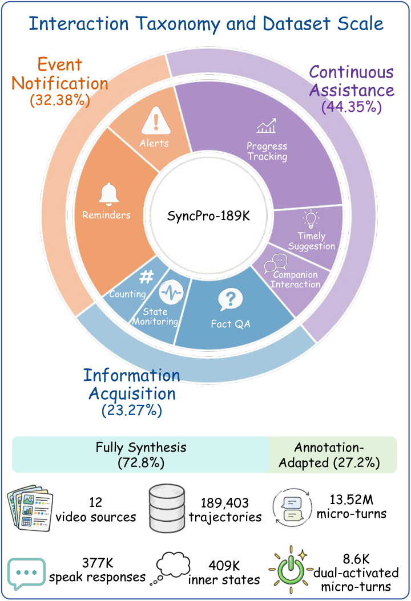

# SyncPro: Synchronous Reasoning and Responding for Proactive Streaming Video Understanding

<p align="center">
  
</p>

<p align="center">
  <a href="https://eureka-maggie.github.io/SyncPro/"></a>
  <a href="https://eureka-maggie.github.io/SyncPro/paper/SyncPro.pdf"></a>
  <a href="https://huggingface.co/datasets/EurekaTian/SyncPro-189k"></a>
  <a href="https://github.com/Eureka-Maggie/SyncPro"></a>
  <a href="LICENSE"></a>
</p>

SyncPro is a proactive streaming-video model that learns when to keep reasoning, when to stay silent, and when to respond. Its dual-stream decoder separates an internal reasoning stream from an external response stream while preserving causal, frame-by-frame processing.

This repository provides the training implementation and portable data contracts for the paper. Full training and validation annotations are distributed only through [SyncPro-189k](https://huggingface.co/datasets/EurekaTian/SyncPro-189k) on Hugging Face. Videos are not redistributed.

Explore the [project page](https://eureka-maggie.github.io/SyncPro/) for the paper, method, dataset, benchmark comparisons, and source-synchronized Inner and Response demonstrations with music and silent versions.

## Highlights

- **Synchronous dual streams.** Internal reasoning and external response tokens are generated together, with a fixed additive merge coefficient γ = 0.5.
- **Timing-aware SFT.** Split action loss is paired with Action Temporal Ranking (ATR), which contrasts the correct activation time against nearby hard negatives.
- **Balanced RL.** A fixed-order 50-step schedule balances four proactive behavior groups and optimizes chronological hard-window F1.
- **189K trajectories.** The SFT release contains 189,403 streaming trajectories and 13.52M frame-level micro-turns from 12 public research sources.

## Method

<p align="center">
  
</p>

For each video step, SyncPro forks the decoder into a reasoning branch \(B\) and a response branch \(A\). Their hidden states are combined as

\[
h = h_A + 0.5 h_B,
\]

and the two outputs follow a constrained grammar:

- Branch B: `<silent>` or `<inner>...</inner>`
- Branch A: `<silent>` or `<speak>...</speak>`

The released SFT recipe uses Qwen3.5-4B, dual LoRA with rank 64, α = 128, dropout 0.05, restricted-binary split action loss, and ATR with λ = 0.05, margin 0.5, radius 4, and one hard negative.

## Installation

Linux, Python 3.11, and CUDA GPUs are recommended. Install a CUDA-compatible PyTorch build first.

```bash
git clone https://github.com/Eureka-Maggie/SyncPro.git
cd SyncPro
python3 -m venv .venv
source .venv/bin/activate
python -m pip install --upgrade pip
python -m pip install torch==2.10.0
python -m pip install -e .
python -m pip install -r requirements/release.txt --no-build-isolation
```

The reference launchers use eight GPUs by default. Batch sizes and distributed settings can be overridden through environment variables.

## Data

<p align="center">
  
  
</p>

The Hugging Face release contains annotations only:

| Configuration | Split | Rows | Contents |
|---|---:|---:|---|
| `sft` | train | 189,403 | Dual-stream conversations and portable frame references |
| `rl` | train | 800 | Balanced fixed-order optimization schedule |
| `rl` | validation | 58 | StreamingBench, OVO-Bench, and ProactiveVideoQA annotations |

```python
from datasets import load_dataset

sft = load_dataset("EurekaTian/SyncPro-189k", "sft", split="train")
rl_train = load_dataset("EurekaTian/SyncPro-189k", "rl", split="train")
rl_validation = load_dataset("EurekaTian/SyncPro-189k", "rl", split="validation")
```

The original videos must be obtained from their publishers and used under their respective terms. Source links, schemas, path conventions, and attribution details are collected in [docs/DATA.md](docs/DATA.md).

To download the annotation release after accepting its terms and authenticating with Hugging Face:

```bash
hf auth login
hf download EurekaTian/SyncPro-189k \
  --repo-type dataset \
  --local-dir /path/to/SyncPro-189k
```

The GitHub repository intentionally contains only small schema examples; the complete SFT and RL annotations must be obtained from Hugging Face.

## Training

### Supervised fine-tuning

```bash
gzip -cd /path/to/SyncPro-189k/sft/train-*.jsonl.gz \
  > /path/to/SyncPro-189k/sft/train.jsonl
export MODEL_PATH=/path/to/Qwen3.5-4B
export SFT_TRAIN_DATA=/path/to/SyncPro-189k/sft/train.jsonl
export SFT_VAL_DATA=/path/to/validation.jsonl
export OUTPUT_DIR=$PWD/outputs/sft_split_atr
bash scripts/train_sft.sh
```

The launcher writes a runtime contract before training and refuses incompatible checkpoint resumes. γ remains fixed at 0.5 throughout SFT.

### Reinforcement learning

Copy the root template, fill in the local video locations, and launch from the final SFT checkpoint:

```bash
cp configs/video_roots.example.env configs/video_roots.env
# Edit DATASET_ROOT in configs/video_roots.env.
source configs/video_roots.env

export SFT_CHECKPOINT=$PWD/outputs/sft_split_atr/checkpoint-100
export SYNCPRO_DATA_DIR=/path/to/SyncPro-189k
export OUTPUT_DIR=$PWD/outputs/rl_balanced_hard_f1
bash scripts/train_rl.sh
```

The paper configuration uses query batch size 16, group size 4, 60 sampled frames, 50 optimizer steps, and the released balanced order. See [docs/TRAINING.md](docs/TRAINING.md) for the full contracts and preflight commands.

## Evaluation

The paper evaluates proactive response timing on [StreamingBench](https://streamingbench.github.io/), [OVO-Bench](https://github.com/JoeLeelyf/OVO-Bench), and [ProactiveVideoQA](https://github.com/yellow-binary-tree/ProactiveVideoQA). The submitted model achieves 41.2 Acc@2s on StreamingBench-PO, 34.19 mean F1 on OVO-Bench FAR, and 32.43 PAUC on ProactiveVideoQA VAD.

Evaluation task mappings and dataset access notes are in [docs/EVALUATION.md](docs/EVALUATION.md).

## Repository layout

```text
SyncPro/
├── assets/                       # Paper figures used in this README
├── configs/                      # Local video-root template
├── data/examples/                # Minimal schema examples only
├── data/system_prompt_dual.txt   # Released dual-stream system prompt
├── docs/                         # Data, training, and evaluation guides
├── examples/models/qwen3_5/      # Dual-stream model and runtime contracts
├── examples/rl/                  # Timing dataset and reward implementation
├── scripts/train_sft.sh          # Fixed-γ split-loss + ATR recipe
├── scripts/train_rl.sh           # Balanced hard-F1 RL recipe
└── tests/test_release_contract.py
```

## Paper

**SyncPro: Synchronous Reasoning and Responding for Proactive Streaming Video Understanding**

Tian Xueyun, Bingbing Xu, Jiaming Liu, Jinpeng Yu, Yang Shi, Yu Zhao, Ruihua Huang, Yuanzhuo Wang, and Huawei Shen.

[Read the paper](https://eureka-maggie.github.io/SyncPro/paper/SyncPro.pdf) · [BibTeX](https://eureka-maggie.github.io/SyncPro/paper/SyncPro.bib)

## Licenses and attribution

- Code in this repository is released under the [Apache License 2.0](LICENSE).
- SyncPro-189k annotations are released under [CC BY-NC-SA 4.0](https://creativecommons.org/licenses/by-nc-sa/4.0/), subject to the underlying source-dataset terms.
- No source videos, extracted frames, model checkpoints, or third-party benchmark assets are redistributed.
- This implementation includes modified portions of [ms-swift](https://github.com/modelscope/ms-swift); its Apache-2.0 notices are retained. See [THIRD_PARTY_NOTICES.md](THIRD_PARTY_NOTICES.md).

## Contributing

Bug reports and focused pull requests are welcome. Please read [CONTRIBUTING.md](CONTRIBUTING.md) before submitting changes. For security-sensitive reports, follow [SECURITY.md](SECURITY.md).
